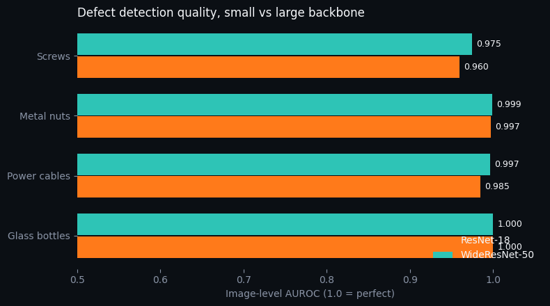
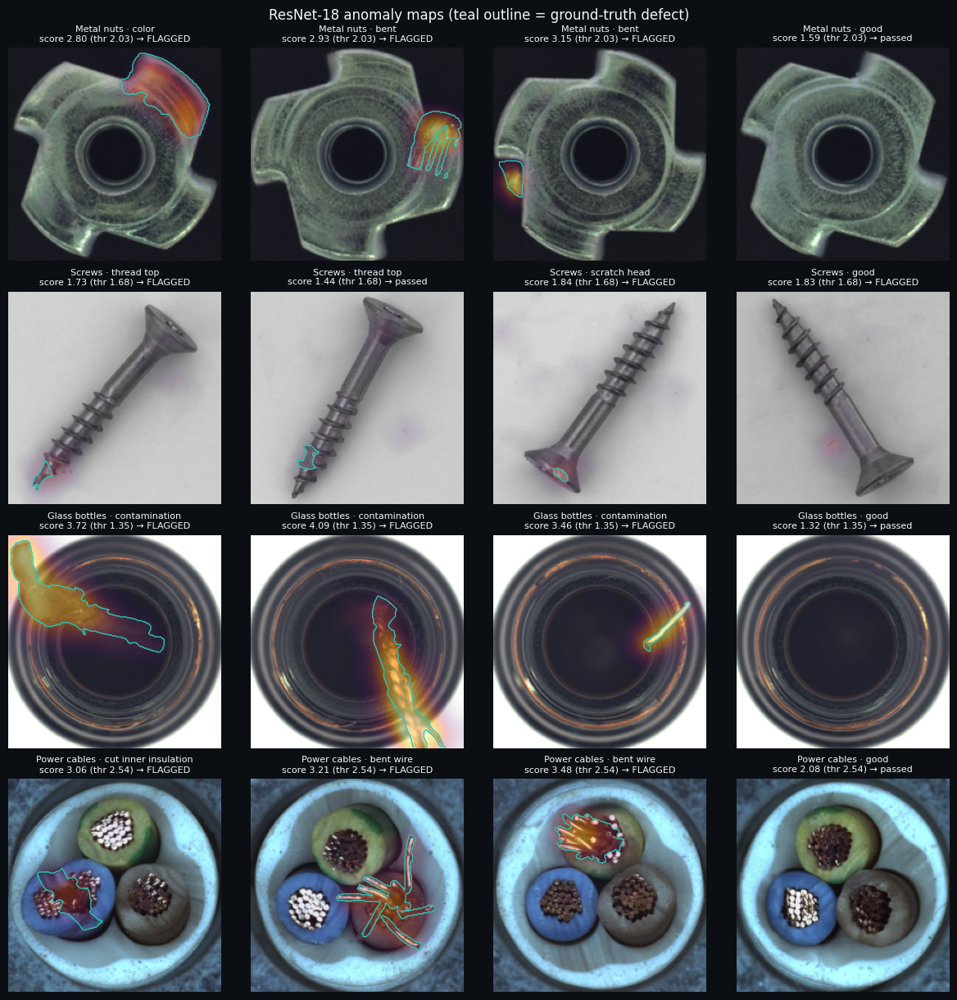

# 23N Field Tests #02: Small Model, Big Factory

## Results (free Colab T4, 15 Nov 2026)

**A ResNet-18 on a ₹45,000 CPU box flags 88% of defects at ₹0.16 per 1,000 parts.**

| Product line | ResNet-18 AUROC | WideResNet-50 AUROC | ResNet-18 caught | ResNet-18 false alarms |
|---|---|---|---|---|
| Metal nuts | 0.997 | 0.999 | 91/93 | 2/22 |
| Screws | 0.960 | 0.975 | 91/119 | 1/41 |
| Glass bottles | 1.000 | 1.000 | 63/63 | 5/20 |
| Power cables | 0.985 | 0.997 | 77/92 | 1/58 |
| **Mean** | **0.985** | **0.993** | **88%** | **6%** |

ResNet-18 takes about 202 ms per part on 2 CPU threads; WideResNet-50 takes 650–830 ms per part, roughly 3.5× slower. The larger model catches more screw and cable defects, so the gap is real but small. Costs are estimates; the assumptions are in the notebook.

📓 [Run notebook with outputs](ft02_small_model_defects_executed.ipynb) · 🌐 [HTML version](https://23nlabs.github.io/field-tests/ft02_small_model_defects_executed.html)

**Question:** can a small model on a cheap CPU catch manufacturing defects as well as a large one, at a fraction of the cost?

We fit a PatchCore-style anomaly detector on photos of good parts only. It is written from scratch with torchvision and a k-NN memory bank, with no training loop and no defect labels. We test it on four product lines that matter to Indian manufacturing: metal nuts, screws, glass bottles and power cables. For each line the notebook:

- measures image-level **AUROC** for a small backbone (ResNet-18, ~12M params) and a large one (WideResNet-50, ~69M params);
- sets an alarm threshold from held-out *good* parts, then reports the **% of defects caught** and the **% of good parts falsely flagged**;
- times inference on the **CPU** (our edge proxy) and on the GPU if there is one;
- turns that time into **₹ per 1,000 inspections** on an amortised CPU box. All the assumptions are named variables;
- optionally runs a zero-shot test of a **frontier vision model** (Claude via the `anthropic` SDK) on 40 images. This step is skipped when no API key is set;
- renders anomaly heatmaps, a Gradio demo (upload a part and get a score and a heatmap), a 58-second 1080×1080 video, a 1080×1350 cover image and the post text, all filled in with the numbers from the run.

Headline format, computed at runtime: *"A ResNet-18 on a ₹45,000 CPU box flags N% of defects at ₹Y per 1,000 parts."*

## Dataset and licence

**MVTec AD**, from Bergmann et al., CVPR 2019 and IJCV 2021: https://www.mvtec.com/company/research/datasets/mvtec-ad

- The notebook downloads one archive per category from MVTec's official links (https://www.mvtec.com/company/research/datasets/mvtec-ad/downloads). They need no login or form. The four categories add up to about 970 MB (bottle 148 MB, cable 481 MB, metal_nut 157 MB, screw 186 MB).
- **Licence: CC BY-NC-SA 4.0, non-commercial only.** This is an independent research study on public data, with no affiliation with MVTec or any manufacturer. A production system must be trained on your own images.
- If MVTec AD is already attached as a Kaggle input, or `MVTEC_ROOT` points to a copy, the notebook uses that copy instead of downloading.

## How to run

1. Click the Colab badge, choose Runtime → Change runtime type → **T4 GPU**, then **Run all**.
2. It takes about 12–18 minutes on a T4. Roughly a third of that is the download. A CPU-only runtime takes about 20–25 minutes because the notebook automatically uses a smaller memory bank (`CORESET_RATIO`).
3. Outputs: `ft02_video.mp4` and `ft02_cover.png` (downloaded automatically on Colab), plus `ft02_outputs/` (AUROC chart, heatmap grid, filled post text).
4. Optional: add `ANTHROPIC_API_KEY` in Colab Secrets or Kaggle Secrets to run the frontier-model comparison. At list prices it costs well under US$0.50.

It also runs on Kaggle notebooks. Turn on Internet in the notebook settings, or attach MVTec AD as a dataset.

## Method in one paragraph

An ImageNet-pretrained CNN produces layer2 and layer3 feature maps. Each map is smoothed with a 3×3 average pool and upsampled to a 28×28 grid, which gives one descriptor per patch. A greedy k-center coreset of all good-part patches becomes the memory bank. At test time, each patch's distance to its nearest neighbour in the bank forms the anomaly map, and the largest distance is the image score. The threshold is the 99th percentile of scores on held-out good training images.

## Limitations

- These are lab photos from a fixed camera with controlled light. Real production lines will score lower until you re-collect good images on your own line.
- Each category has only 40–90 defective test images, so treat AUROC differences of ±0.01 as noise.
- The PatchCore here is simplified: 224 px crops, no dimension reduction, and a smaller coreset on CPU. Published PatchCore scores are higher, and small defects on screws are hurt most by the low resolution.
- Latency is measured on the notebook's CPU (2 vCPUs on free Colab) at batch size 1, including PNG decoding. ONNX/OpenVINO export or INT8 would make it faster. ARM boards were not tested.
- The ₹ cost is an **estimate** of compute only. It leaves out the camera, lighting, integration and labour.
- The frontier-model comparison is a zero-shot baseline on 40 images with no reference images and no prompt tuning.
- MVTec AD is non-commercial (CC BY-NC-SA 4.0).

## References

- Bergmann, Fauser, Sattlegger, Steger. *MVTec AD: A Comprehensive Real-World Dataset for Unsupervised Anomaly Detection.* CVPR 2019.
- Bergmann et al. *The MVTec Anomaly Detection Dataset.* IJCV 2021.
- Roth et al. *Towards Total Recall in Industrial Anomaly Detection* (PatchCore). CVPR 2022.

*23N AI Labs · Gandhinagar, India · 23nlabs.com*
