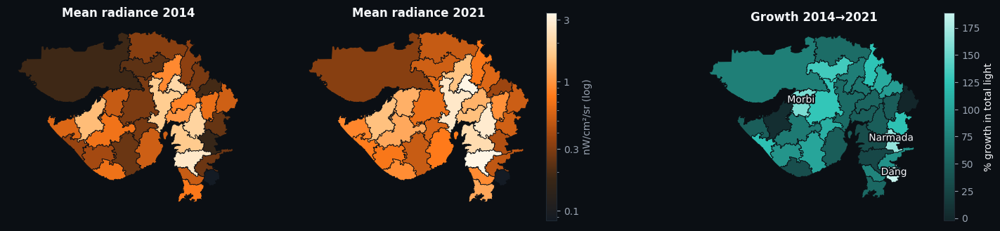
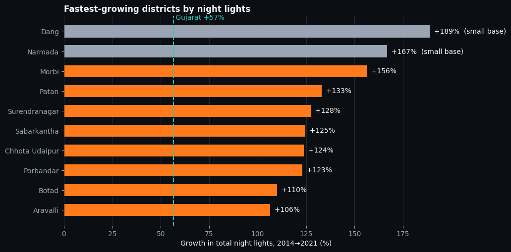

# 23N Field Tests #03 — Gujarat from Space: Night Lights as an Economic Pulse

## Results (free Colab CPU, 15 Nov 2026)

**From space, Morbi grew its lights 156% from 2014 to 2021, the fastest in Gujarat** among districts with a meaningful 2014 base.

- **Gujarat overall:** +57% total night light (6.6% a year).
- **Biggest absolute gain:** Ahmedabad (+58%).
- **Robustness:** averaging two years at each end, Morbi grows +123% and ranks 3rd, so "among the fastest" is the safer wording.
- **Why 2021:** the source switches processing versions in 2022 (VNL V2.1 to V2.2). The notebook detected this step and ended the comparison at 2021 rather than mixing the two products.
- **Earlier run:** the first run, before the background-masking fix in commit `3bf8cad`, wrongly showed lights falling and should be ignored.

📓 [Run notebook with outputs](ft03_night_lights_gujarat_executed.ipynb) · 🌐 [HTML version](https://23nlabs.github.io/field-tests/ft03_night_lights_gujarat_executed.html)

**Question:** Which Gujarat districts' economic activity grew fastest, measured from space?

The notebook adds up VIIRS satellite night-time light inside each of Gujarat's 33 district boundaries for every year
from 2014 to the latest available year (2024). It then computes growth and CAGR, ranks the districts, checks known
hot-spots (Mundra, Khavda, Dahej, GIFT City, Hazira, Dholera, Sanand, Morbi, Kevadia), and produces:

* the headline, computed at runtime: *"From space, &lt;District&gt; grew its lights X% since 2014 — fastest in Gujarat."*
* maps, a top-10 chart and indexed district trajectories,
* a Gradio Q&A over the district table. Answers come from a deterministic lookup. On a GPU, Qwen2.5-1.5B-Instruct rephrases them.
* a 58-second 1080×1080 video (`ft03_video.mp4`) and a 1080×1350 cover (`ft03_cover.png`),
* LinkedIn and X post text filled with the computed numbers.

## Data and licences
| What | Source | Licence | Login |
|---|---|---|---|
| Annual night lights 2014–2024, 500 m | OpenGeoHub, *Annual global nighttime lights at 500 m*, Zenodo record [17294744](https://zenodo.org/records/17294744) (concept DOI [10.5281/zenodo.7750174](https://doi.org/10.5281/zenodo.7750174)). The 2012–2024 layers are EOG **Annual VNL V2** (Elvidge et al., 2021), stored ×10 as Cloud-Optimized GeoTIFFs | CC BY 4.0 | None |
| District boundaries (33 districts, LGD codes) | [datta07/INDIAN-SHAPEFILES](https://github.com/datta07/INDIAN-SHAPEFILES) `STATES/GUJARAT/GUJARAT_DISTRICTS.geojson`, pinned to commit `08490ea`, with a jsDelivr mirror as fallback | MIT (repository licence) | None |

The notebook reads only the Gujarat window of each yearly COG over HTTP range requests, which is a few MB per year. If
range reads fail, it downloads the full file (about 60–85 MB per year), crops it and deletes it. The result is cached in
`ft03_data/`. The notebook's Data section compares this route with the login-gated ones (Earth Engine, NASA Black Marble,
EOG direct) and gives the exact Earth Engine steps for anyone who prefers that route.

## How to run
1. Click **Open in Colab** and choose **Runtime → Run all**. A CPU runtime works. A T4 GPU only switches on the small-LLM answers in the demo.
2. Expected runtime is about 6–15 minutes. Most of it is Zenodo download time (~1–2 min with range reads, up to ~10 min on the full-download fallback) and the video render (~1–3 min). The LLM download adds ~1–2 min on GPU.
3. On **Kaggle**, turn *Internet* on in the notebook settings. `files.download` is skipped there, so the mp4 and png stay in the working directory.
4. The knobs are named variables at the top: `BASE_YEAR`, `LAST_YEAR_WANTED`, `MIN_BASE_SHARE`, `LIT_THRESHOLD`, `USE_LLM`.

## Method, in brief
Sum of lights (SOL) = total radiance of all ~500 m pixels whose centre falls in a district. Growth = SOL(latest)/SOL(2014) − 1.
CAGR is computed over the same span, and the growth is recomputed on 2-year averages at each end as a robustness check. To claim
the headline, a district needs at least 0.5% of Gujarat's 2014 light, so a near-dark district can't win on a tiny base. The
unfiltered leader is printed as well.

## Limitations
* Night lights are a **proxy** for activity, not GDP. They miss services and anything that doesn't glow, and over-weight bright industrial sites.
* **No lights→GDP regression.** We found no open, machine-readable district GDP table for Gujarat. There is a hook (`GDDP_CSV`) if you have one.
* EOG changed Annual VNL from **V2.1 (to 2021) to V2.2 (2022+)**. The notebook prints the 2021→2022 state-level jump so you can judge whether there is a step.
* OpenGeoHub's copy caps radiance at 200 nW/cm²/sr, so saturated city cores can understate growth in Ahmedabad and Surat. Gas flares are not removed separately.
* The 2014-era 33-district map has no **Vav-Tharad** (created in 2025). The boundary file is community-made, not an official survey map.
* Hot-spots are circles around approximate coordinates, not official site boundaries.

*Independent study on public data by 23N AI Labs, Gandhinagar. Not affiliated with, or endorsed by, any company,
government body or data provider named here.*
